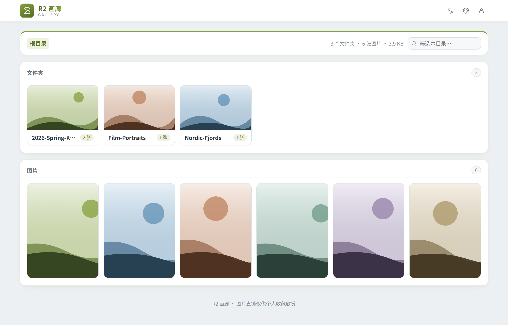
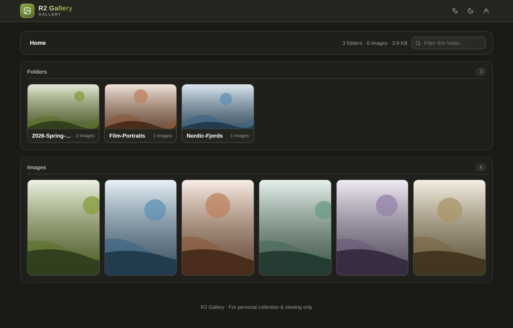
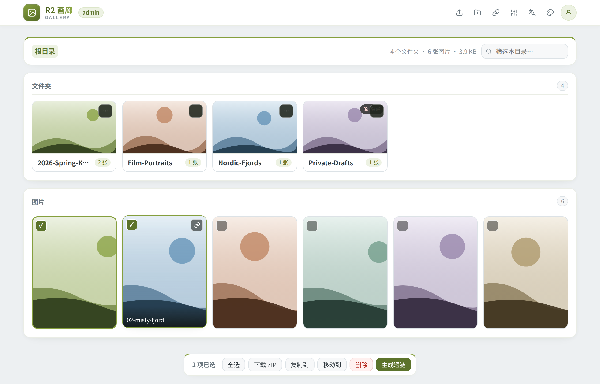
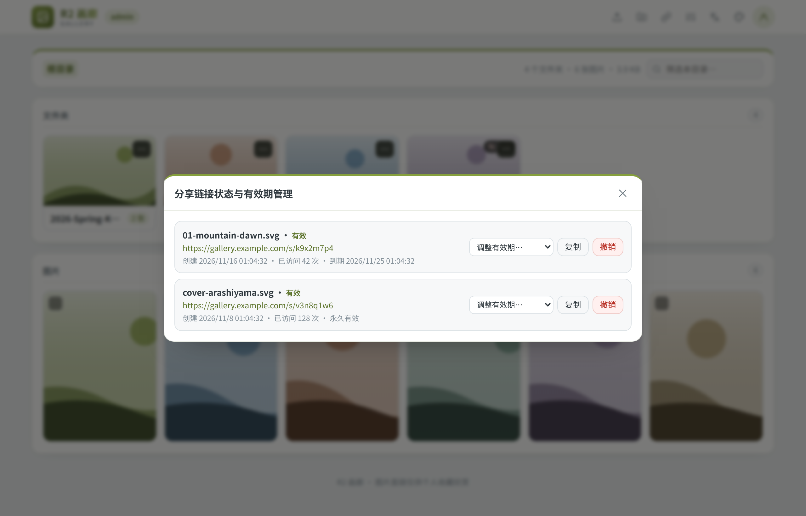

<div align="center">

# R2 Image Hub

**A self-hosted image gallery, online file manager, and high-performance direct-link proxy built on Cloudflare Workers & R2.**<br>
Zero external database dependencies (no D1 / Durable Objects / KV required) · Powered by the underlying `render` static proxy engine · Ready out of the box.

[](https://workers.cloudflare.com/)
[](https://www.cloudflare.com/developer-platform/r2/)
[](https://www.typescriptlang.org/)
[](./LICENSE)

[简体中文](./README.md) · **English**

</div>

---

## Screenshots

| Classic Olive Theme (Visitor View · 中文) | Dark Theme (Visitor View · English) |
|:---:|:---:|
|  |  |
| **Administrator Mode (Batch Selection · Hidden Folders)** | **Short Share Links & Expiration Manager** |
|  |  |

---

## Editions

Two editions are available in this repository depending on your use case:

| Edition | Ref | Description |
|:---|:---|:---|
| **Full Edition (Recommended)** | `main` branch | **Underlying `render` Engine + Full Gallery**: Retains the full `kotx/render` R2 static object proxy engine (`Range` requests, `ETag` / conditional requests, Worker Cache API, `PATH_PREFIX`, `INDEX_FILE` / `NOTFOUND_FILE` fallbacks, and CORS headers) seamlessly integrated with the interactive gallery UI and administrator file/folder manager. |
| **Gallery-Only Edition** | Tag `v1.6.0-gallery-only` | **Pure Gallery Edition**: Strips out generic static-site hosting options (`INDEX_FILE`, `NOTFOUND_FILE`, `PATH_PREFIX`, etc.) and keeps only the pure R2 photo gallery, lightbox viewer, administrator album/folder management, and short share links. |

---

## Key Features

### 1. Underlying `render` High-Performance R2 Proxy Engine
- **Full HTTP Semantics**: Native support for `GET`, `HEAD`, `OPTIONS`, and HTTP `Range` requests (`206 Partial Content`) for progressive large-image loading and media streaming.
- **Conditional Requests & Edge Caching**: Handles `ETag`, `If-Match`, `If-None-Match` (`304 Not Modified`), `If-Modified-Since`, `If-Unmodified-Since`, and `If-Range`. Static assets are cached at the edge via the Cloudflare Worker Cache API, while dynamic directory listings use `no-store` to reflect real-time visibility and auth state.
- **Zero-Database Metadata Isolation**: Gallery settings and share link records are stored directly inside the same R2 bucket under the private `.r2-explorer/` prefix. Public direct-link routes strictly block any external access to `.r2-explorer/*` (always returning `404`).

### 2. Visual Polish & Internationalization
- **Universal Graphic Logo**: Uses a clean, theme-adaptive SVG mountain-and-frame emblem in the top bar for a language-neutral look across all locales.
- **Three Built-in Themes**: Ships with **Classic Olive (default)**, **Light**, and **Dark** themes, persisted automatically in `localStorage`.
- **Bilingual UI (English / 简体中文)**: Instant language switching from the top bar. Only UI controls and system messages are translated—user file names and folder paths are never altered.
- **Frictionless Visitor Browsing**: Visitors can browse public folders without signing in, view albums sorted in natural order (`photo2` before `photo10`), filter files in real time, and inspect images in a keyboard-friendly lightbox (`←` / `→` / `Esc`).

### 3. Administrator File & Folder Management
- **Secure Cookie Authentication**: Sign in via the top-right avatar button. Sessions use `HttpOnly`, `SameSite=Lax`, HMAC-SHA256 signed cookies (valid for 30 days) with same-origin protection on all mutation endpoints.
- **File Operations**: Multi-file upload (with conflict detection to prevent accidental overwrites), new folder creation (`.keep` placeholder), streaming multi-file ZIP download (Store mode, streamed directly without buffering entire archives in Worker memory), batch copy, batch move, and batch delete.
- **Recursive Folder Operations**: Click `…` on any folder card to **rename, move, or recursively delete** folders:
  - Folder move/rename runs in bounded batches with ETag and byte-size verification before removing source objects, and can resume after a page refresh.
  - Renaming or moving a folder **automatically remaps** hidden-folder rules and existing short share links so shared URLs never break.
  - Recursive folder deletion requires typing the full folder path to confirm and safely paginates across directories with more than 1,000 objects.

### 4. Short Share Links & Folder Visibility Control
- **Short Share Links (`/s/<id>` & `/share/<id>`)**: Compatible with `r2-explorer`'s `.r2-explorer/sharable-links/<id>.json` schema. Create links expiring in 1 hour, 1 day, 7 days, 30 days, or never; inspect view counts, adjust expiration, or revoke links anytime.
- **Hidden Folders**: Mark any folder as hidden from the public gallery. Visitors cannot see or list hidden folders in the gallery UI, while direct file URLs continue to work through the underlying `render` proxy. Administrators can view and manage all hidden folders when signed in.

---

## Quick Start

### 1. Install Dependencies

Requires Node.js 18+ and `pnpm`.

```bash
pnpm install
```

### 2. Local Development

Copy the example environment file and configure a local administrator password:

```bash
cp .dev.vars.example .dev.vars
```

Edit `.dev.vars`:

```ini
ADMIN_USERNAME=admin
ADMIN_PASSWORD=your-l…word
```

Start the local dev server:

```bash
pnpm dev
```

---

## Deploying to Cloudflare Workers

1. Update `wrangler.toml` and set `bucket_name` and `preview_bucket_name` under `[[r2_buckets]]` to your Cloudflare R2 bucket name:

```toml
[[r2_buckets]]
binding = "R2_BUCKET"
bucket_name = "your-r2-bucket-name"
preview_bucket_name = "your-r2-bucket-name"
```

2. Set the production administrator password secret (required):

```bash
pnpm exec wrangler secret put ADMIN_PASSWORD
```

3. Deploy the Worker:

```bash
pnpm run deploy
```

---

## Configuration Reference (`wrangler.toml` & Secrets)

### Secrets & Authentication Variables

| Name | Type | Default | Description |
|:---|:---|:---|:---|
| `ADMIN_PASSWORD` | Secret (Required) | None | Administrator password (sign-in is disabled until configured) |
| `ADMIN_USERNAME` | Var / Secret | `"admin"` | Administrator username |
| `ADMIN_SECRET` | Secret (Optional) | Auto-generated | HMAC signing key for session cookies; auto-generated and saved in `.r2-explorer/gallery-config.json` if omitted |
| `BUCKET_NAME` | Var (Optional) | `"R2_BUCKET"` | Bucket label recorded in share link metadata |

### Underlying `render` & Gallery Variables (`[vars]`)

| Name | Default | Description |
|:---|:---|:---|
| `DIRECTORY_LISTING` | `true` | Render the gallery UI when requesting directory paths ending with `/` |
| `HIDE_HIDDEN_FILES` | `true` | Hide files and folders starting with `.` from public directory listings |
| `ITEMS_PER_PAGE` | `1000` | Maximum objects listed per page (up to `1000` with `r2_list_honor_include`) |
| `CACHE_CONTROL` | `"max-age=2592000"` | Default `Cache-Control` header for static object responses; set to `"no-store"` to disable caching |
| `DIRECTORY_CACHE_CONTROL` | `"no-store"` | Cache policy for gallery directory pages |
| `ALLOWED_ORIGINS` | `""` | `Access-Control-Allow-Origin` header for static responses |
| `PATH_PREFIX` | `""` | Prefix prepended to all R2 object keys (Full Edition only) |
| `INDEX_FILE` | `""` | Index file served on directory requests, e.g. `"index.html"` (Full Edition only; leave empty for gallery UI) |
| `NOTFOUND_FILE` | `""` | Custom 404 fallback object key at the root of the bucket (Full Edition only) |
| `LOGGING` | `true` | Log cache misses and R2 retry attempts |
| `R2_RETRIES` | `0` | Number of exponential-backoff retries for R2 operations (`-1` for unlimited) |

---

## Automated Regression Tests

Includes 34 isolated end-to-end checks powered by Miniflare (in-memory R2) and Playwright Chromium, covering authentication, >1,000-object paginated folder deletion, move/rename conflict protection, share link remapping, HTTP `Range` semantics, bilingual UI switching, and responsive viewports:

```bash
# TypeScript typecheck
pnpm check

# Run full E2E regression suite
pnpm test
```

---

## Acknowledgements & License

- Underlying R2 static object proxy and HTTP `Range` handling derived from [kotx/render](https://github.com/kotx/render).
- Share link metadata format compatible with [G4brym/R2-Explorer](https://github.com/G4brym/R2-Explorer).
- Released under the [MIT License](./LICENSE).
