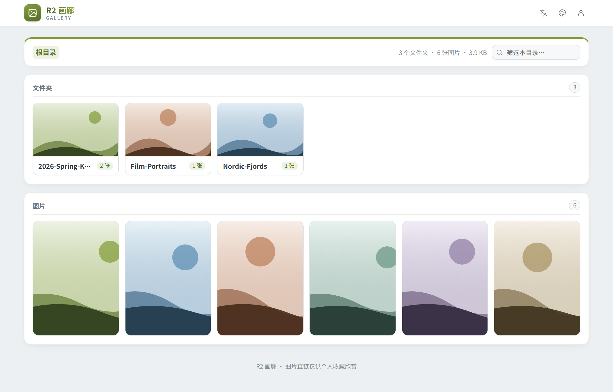
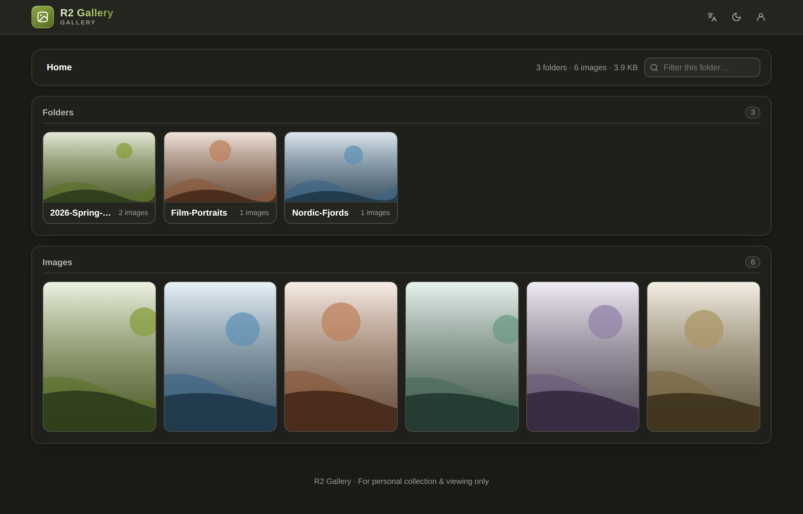
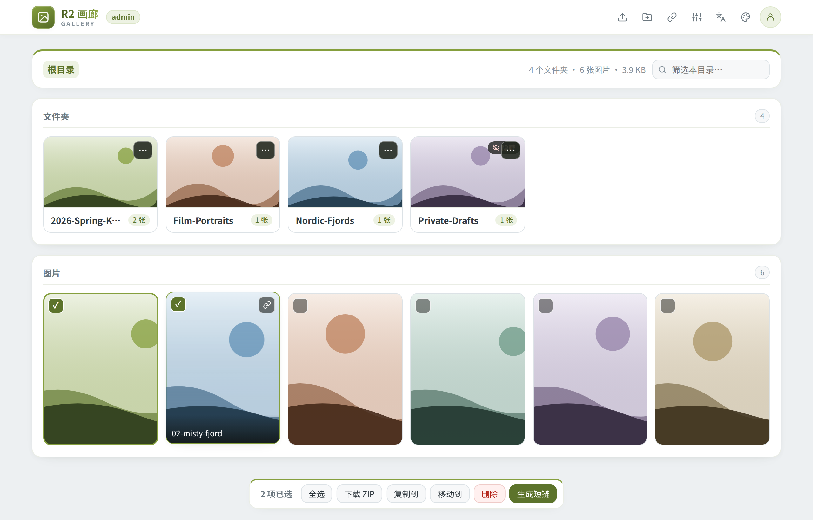

<div align="center">

# R2 Image Hub (R2 图床画廊)

**基于 Cloudflare Workers + R2 的自托管图片画廊、在线文件管理器与高性能直链渲染代理。**<br>
零外部数据库依赖（无需 D1 / Durable Objects / KV） · 原生融合底层 `render` 静态文件直链引擎 · 开箱即用。

[](https://workers.cloudflare.com/)
[](https://www.cloudflare.com/developer-platform/r2/)
[](https://www.typescriptlang.org/)
[](./LICENSE)

**简体中文** · [English](./README.en.md)

</div>

---

## 界面预览

| 经典榄绿主题（访客视图 · 简体中文） | 深色模式（访客视图 · English） |
|:---:|:---:|
|  |  |
| **管理员模式（多选批量操作 · 隐藏目录管理）** | **分享短链状态与有效期管理** |
|  |  |

---

## 版本说明（Editions）

本仓库提供两个版本，可根据使用场景自由选择：

| 版本 | 位置 | 适用场景与说明 |
|:---|:---|:---|
| **完整版（Full Edition，默认推荐）** | `main` 主分支 | **底层 `render` 引擎 + 画廊完整版**：完整保留底层 `kotx/render` 的 R2 静态文件直链代理、HTTP `Range` 分片、条件请求（`ETag` / `If-None-Match`）、Worker Cache 边缘缓存、`PATH_PREFIX`、`INDEX_FILE` / `NOTFOUND_FILE` 回退与 CORS 控制，同时集成完整的画廊浏览与管理员在线管理后台。 |
| **纯画廊版（Gallery-Only Edition）** | Tag `v1.6.0-gallery-only` | **仅画廊功能纯净版**：剥离底层 `render` 的通用静态站点托管配置（`INDEX_FILE`、`NOTFOUND_FILE`、`PATH_PREFIX` 等），仅保留纯粹的在线相册目录浏览、高清灯箱看图、管理员相册/文件夹管理与短链分享。 |

---

## 核心特性

### 1. 底层 `render` 高性能 R2 直链代理引擎
- **完整 HTTP 语义支持**：原生支持 `GET`、`HEAD`、`OPTIONS` 与 `Range` 字节范围请求（`206 Partial Content`），满足大图渐进加载与音视频流式拖动播放。
- **条件缓存与边缘加速**：完整处理 `ETag`、`If-Match`、`If-None-Match`（`304 Not Modified`）、`If-Modified-Since`、`If-Unmodified-Since` 与 `If-Range`，对静态对象自动接入 Cloudflare Worker Cache API，目录动态页采用 `no-store` 防止状态串扰。
- **元数据安全隔离**：画廊配置与短链记录直接保存在同一 R2 桶的私有前缀 `.r2-explorer/` 下，无需额外部署数据库；底层直链路由严格拦截所有针对 `.r2-explorer/*` 的外部读取请求（固定返回 `404`）。

### 2. 视觉体验与国际化
- **无文字隔阂的图形 Logo**：顶栏采用自适应主题配色的画框山月矢量徽标（SVG），兼顾中文与非中文用户审美。
- **三套精致主题**：内置 **经典榄绿（Classic Olive，默认）**、**简约浅色（Light）**、**深色模式（Dark）**，偏好自动持久化在浏览器本地。
- **中英双语切换（简体中文 / English）**：顶栏一键切换界面语言；翻译引擎严格限定于 UI 控件与提示文案，绝不篡改用户文件名或文件夹路径。
- **访客零门槛看图**：无需登录即可浏览公开相册、按自然序（如 `photo2` 排在 `photo10` 前）排列图片、实时过滤当前目录文件名、打开高清灯箱（支持键盘 `←` / `→` 翻页、`Esc` 关闭及查看原图）。

### 3. 管理员在线文件与文件夹管理
- **轻量安全鉴权**：点击右上角头像图标登录，采用 `HttpOnly` + `SameSite=Lax` + HMAC-SHA256 签名会话 Cookie（有效期 30 天），管理接口默认拒绝跨站请求。
- **文件级批量操作**：支持多文件直传（同名冲突保护，拒绝静默覆盖）、新建文件夹（`.keep` 占位）、多选流式打包下载 ZIP（Store 模式流式直出，不在 Worker 内存中积压整包）、批量复制到目录、批量移动到目录、批量删除。
- **文件夹级递归操作**：点击文件夹卡片右上角 `…` 即可**重命名、移动、递归删除**整个文件夹：
  - 移动/重命名采用分批复制 + ETag/大小双重校验，全部校验通过后才清理源目录，支持中断后继续操作。
  - 重命名或移动文件夹时，**自动同步更新**隐藏目录配置与关联分享短链的目标路径，已有分享链接不会失效。
  - 递归删除必须手动输入完整文件夹路径确认，支持超过 1000 个对象的大目录跨页完整清理。

### 4. 短链分享与目录显隐控制
- **短链分享（`/s/<id>` & `/share/<id>`）**：复用兼容 `r2-explorer` 的 `.r2-explorer/sharable-links/<id>.json` 存储格式，支持设置 1 小时 / 1 天 / 7 天 / 30 天 / 永久有效，后台弹窗可实时查看访问次数、随时调整有效期或一键撤销。
- **隐藏目录控制**：可将任意文件夹设为“不在公开画廊展示”——未登录访客无法在画廊中看到或列出该目录，但已知完整路径的文件直链仍可通过底层 `render` 正常分发；管理员登录后可随时查看并管理所有隐藏目录。

---

## 快速开始

### 1. 安装依赖

环境要求：Node.js 18+ 与 `pnpm`。

```bash
pnpm install
```

### 2. 本地开发

复制环境变量示例文件并设置本地管理员密码：

```bash
cp .dev.vars.example .dev.vars
```

编辑 `.dev.vars`：

```ini
ADMIN_USERNAME=admin
ADMIN_PASSWORD=your-l…word
```

启动本地开发服务器：

```bash
pnpm dev
```

---

## 部署到 Cloudflare Workers

1. 编辑 `wrangler.toml`，将 `[[r2_buckets]]` 中的 `bucket_name` 和 `preview_bucket_name` 替换为你自己的 R2 桶名：

```toml
[[r2_buckets]]
binding = "R2_BUCKET"
bucket_name = "your-r2-bucket-name"
preview_bucket_name = "your-r2-bucket-name"
```

2. 设置生产环境管理员密码 Secret（必填）：

```bash
pnpm exec wrangler secret put ADMIN_PASSWORD
```

3. 发布 Worker：

```bash
pnpm run deploy
```

---

## 配置参数说明（`wrangler.toml` & Secrets）

### Secrets / 环境变量（管理员与鉴权）

| 变量名 | 类型 | 默认值 | 说明 |
|:---|:---|:---|:---|
| `ADMIN_PASSWORD` | Secret（必填） | 无 | 管理员登录密码（未配置时拒绝登录并提示先配置 `ADMIN_PASSWORD`） |
| `ADMIN_USERNAME` | Var / Secret | `"admin"` | 管理员登录账号名 |
| `ADMIN_SECRET` | Secret（可选） | 自动生成 | 会话 Cookie 的 HMAC 签名密钥；未设置时首次登录自动生成并存入 `.r2-explorer/gallery-config.json` |
| `BUCKET_NAME` | Var（可选） | `"R2_BUCKET"` | 写入分享短链元数据时的桶标识名称 |

### 底层 `render` 与画廊参数（`[vars]`）

| 变量名 | 默认值 | 说明 |
|:---|:---|:---|
| `DIRECTORY_LISTING` | `true` | 访问以 `/` 结尾的目录路径时是否渲染画廊界面 |
| `HIDE_HIDDEN_FILES` | `true` | 在画廊列表中隐藏以 `.` 开头的隐藏文件与内部目录 |
| `ITEMS_PER_PAGE` | `1000` | 单页列出的最大对象数量（上限 `1000`，配合 `r2_list_honor_include` 标志） |
| `CACHE_CONTROL` | `"max-age=2592000"` | 静态文件直链响应的默认 `Cache-Control` 头；设为 `"no-store"` 可关闭 Worker 缓存 |
| `DIRECTORY_CACHE_CONTROL` | `"no-store"` | 目录画廊页面的缓存策略（建议保持 `"no-store"` 以保证登录态与显隐设置实时生效） |
| `ALLOWED_ORIGINS` | `""` | 静态文件直链的 `Access-Control-Allow-Origin` 响应头 |
| `PATH_PREFIX` | `""` | 为所有 R2 请求路径自动拼接的前缀（仅完整版支持） |
| `INDEX_FILE` | `""` | 目录请求的默认索引文件，如 `"index.html"`（仅完整版支持，留空则直接展示画廊） |
| `NOTFOUND_FILE` | `""` | 对象不存在时的自定义 404 回退文件路径（仅完整版支持） |
| `LOGGING` | `true` | 是否在控制台打印缓存未命中与重试日志 |
| `R2_RETRIES` | `0` | R2 读取失败时的指数退避重试次数（`-1` 表示无限重试） |

---

## 自动化测试

内置基于隔离环境（Miniflare 内存 R2 + Playwright Chromium）的 34 项端到端回归测试，覆盖管理员鉴权、大目录分页（>1000 对象）递归删除、文件夹重命名/移动冲突保护、分享短链重映射、Range 分片、中英双语切换与响应式布局检查：

```bash
# TypeScript 类型检查
pnpm check

# 运行完整端到端回归测试
pnpm test
```

---

## 致谢与开源协议

- 底层 R2 静态文件直链与 Range 代理机制源于 [kotx/render](https://github.com/kotx/render)。
- 分享短链元数据格式兼容 [G4brym/R2-Explorer](https://github.com/G4brym/R2-Explorer)。
- 本项目基于 [MIT License](./LICENSE) 开源。
